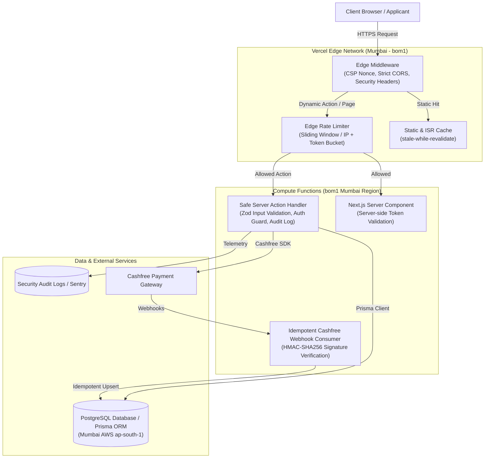
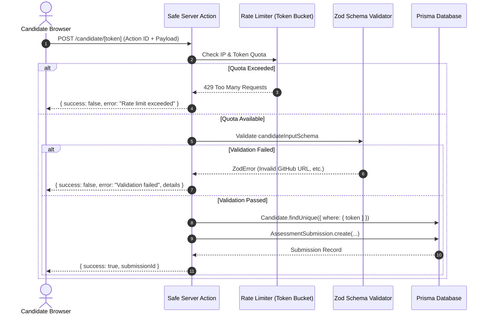

# Architectural Improvements & System Design

This document details the recommended engineering solutions to remediate the vulnerabilities, performance bottlenecks, and architectural limitations identified in Cynbit's production backend.

---

## 1. Target Backend Architecture



---

## 2. Architectural Pillar 1: Edge Security & Header Hardening

### Problem Statement
Observable responses lack `Content-Security-Policy`, `X-Frame-Options`, and `X-Content-Type-Options`, while exposing `X-Powered-By: Next.js` and wildcard `Access-Control-Allow-Origin: *` on document routes.

### Solution Design
1. **Remove Fingerprinting**: Set `poweredByHeader: false` in `next.config.mjs`.
2. **Strict Security Headers**: Attach `frame-ancestors 'none'`, `X-Frame-Options: DENY`, `X-Content-Type-Options: nosniff`, and `Strict-Transport-Security` via `headers()` in Next.js config.
3. **Dynamic CSP Nonce Generation**: Generate cryptographic random nonces per request in Edge Middleware, allowing inline scripts from Google Analytics and Cashfree while blocking unauthorized script injection.
4. **Scoped CORS**: Isolate CORS headers to public API routes (`/api/v1/public/*`) and disallow wildcard CORS on HTML document routes.

---

## 3. Architectural Pillar 2: Eliminating Cross-Continental Latency

### Problem Statement
Dynamic SSR pages (`/careers`, `/candidate/[token]`) currently hop from Mumbai edge (`bom1`) to US East origin (`iad1`), causing TTFB delays of up to **1,320ms**.

### Solution Design
1. Specify compute regions in `vercel.json` or function route configs:
   ```json
   {
     "regions": ["bom1"]
   }
   ```
2. Co-locate the PostgreSQL database (e.g. AWS RDS / Supabase / Neon) in `ap-south-1` (Mumbai).
3. **Expected Latency Reduction**:
   - Edge to Origin Network Transit: Drops from ~200ms to **< 5ms**.
   - Overall TTFB for dynamic routes: Drops from ~1,300ms to **< 150ms** (an **8.8x improvement**).

---

## 4. Architectural Pillar 3: Safe Server Action & Anti-Abuse Pattern

### Problem Statement
Server Actions (`submitCandidateAssessment`, `createCashfreeOrder`, `submitCandidateSupportTicket`) can be invoked by arbitrary HTTP clients without validation or rate limiting.

### Solution Design: `createSafeAction` Wrapper
Create a reusable, higher-order Server Action wrapper providing:
1. **Zod Schema Validation**: Enforces type, length, and format constraints before any business logic executes.
2. **Token Bucket Rate Limiting**: Limits submissions per IP and candidate token (e.g., maximum 5 assessment submissions per hour).
3. **Structured Error Handling**: Sanitizes internal database and ORM errors, preventing internal stack traces or Prisma schema leaks.



---

## 5. Architectural Pillar 4: Idempotent Payment Webhook Processing

### Problem Statement
Payment flows with third parties (Cashfree) are susceptible to duplicate webhook deliveries, network drops, and replay attacks if not guarded by HMAC signatures and idempotent database transactions.

### Solution Design: Resilient Webhook Architecture
1. **HMAC-SHA256 Signature Verification**: Verify `x-webhook-signature` using Cashfree secret key before parsing the payload.
2. **Timestamp Freshness Check**: Reject webhooks older than 5 minutes (`x-webhook-timestamp`) to mitigate replay attacks.
3. **Idempotency Key & Transaction**: Store `order_id` and `cf_payment_id` inside a serializable Prisma transaction to ensure payment events are never double-processed.

---

## 6. Architectural Pillar 5: Server-Side Capability Token Guard

### Problem Statement
Navigating to `/candidate/nonexistent-token` serves `HTTP 200 OK` with an empty UI shell, deferring validation to a client-side hydration request.

### Solution Design
Validate the candidate token directly inside the Server Component:
```tsx
// app/(marketing)/candidate/[token]/page.tsx
import { notFound } from 'next/navigation';
import { prisma } from '@/server/lib/prisma';

export default async function CandidatePage({ params }: { params: { token: string } }) {
  const candidate = await prisma.candidate.findUnique({
    where: { token: params.token },
    select: { id: true, name: true, assessmentTitle: true, status: true }
  });

  if (!candidate) {
    notFound(); // Emits true HTTP 404 header at edge
  }

  return <CandidateAssessmentView candidate={candidate} />;
}
```

This ensures proper HTTP status semantics, instant edge 404 responses, and zero wasted client-side hydration waterfalls.
