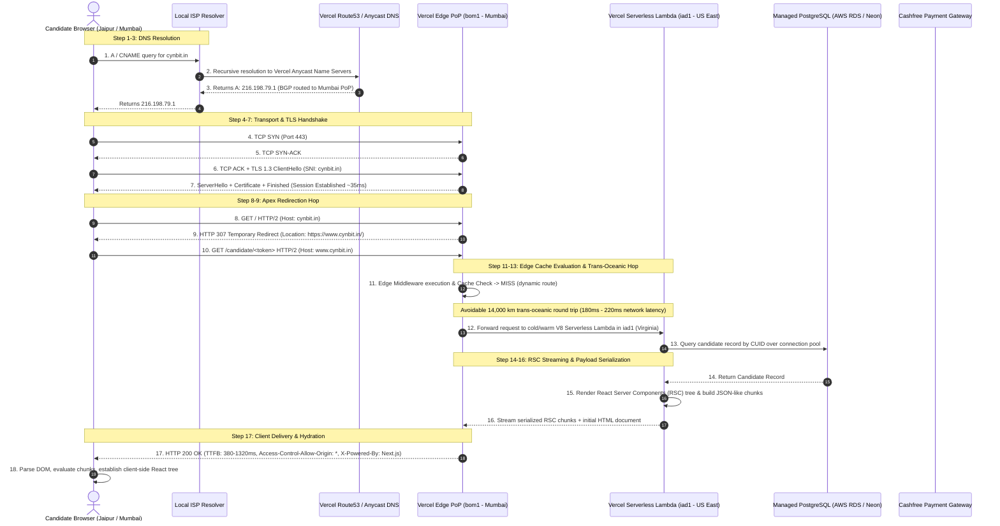

# Deep Dive: 17-Step Packet-Level HTTPS Request/Response Lifecycle

This document provides a low-level, packet-by-packet architectural decomposition of what happens when an Indian candidate accesses Cynbit's platform at `https://cynbit.in` and navigates to the dynamic candidate assessment route (`/candidate/[token]`).

---

## Complete Packet & Execution Sequence

---

## Detailed Step-by-Step Breakdown

### Phase 1: DNS & Anycast Edge Termination (Steps 1–3)
1. **DNS Lookup**: The browser resolves `cynbit.in`.
2. **Anycast Geo-Routing**: Vercel utilizes Anycast BGP routing (`216.198.79.1`). Indian visitors are routed to the nearest physical PoP in Mumbai (`bom1`).
3. **Canonical Subdomain**: `www.cynbit.in` delegates to `e12d688042344235.vercel-dns-017.com`.

### Phase 2: TCP & TLS Handshake (Steps 4–7)
4. **TCP 3-Way Handshake**: A 1-RTT exchange initiates between the candidate device and the Mumbai edge router (`SYN` $\rightarrow$ `SYN-ACK` $\rightarrow$ `ACK`).
5. **TLS 1.3 Negotiation**: Thanks to TLS 1.3 1-RTT (or 0-RTT resumption), cryptographic cipher suites (`TLS_AES_128_GCM_SHA256`) and the Let's Encrypt / DigiCert wildcard certificate are verified in ~35ms.

### Phase 3: The HTTP 307 Inefficiency (Steps 8–9)
6. **Apex Request**: The browser requests `https://cynbit.in`.
7. **Non-Permanent Redirect**: Edge returns `HTTP 307 Temporary Redirect`.
   - *Architectural Flaw*: Because it is a `307` and not a `308 Permanent Redirect`, browsers do not cache the transition in their internal HSTS/redirect caches, incurring this penalty on every raw visit.

### Phase 4: Dynamic Segment Routing & The Trans-Oceanic Penalty (Steps 10–13)
8. **Subdomain Request**: Client initiates `GET /candidate/<token>`.
9. **Edge Cache Lookup**: Vercel Edge inspects cache headers. Segment `[token]` is classified dynamic (`Cache-Control: private, no-cache, no-store`). Cache emits **MISS**.
10. **The Mumbai-to-Virginia Hop (`bom1::iad1`)**:
    - The Mumbai Edge node (`bom1`) opens a backhaul TCP/TLS socket across underwater fiber cables to AWS `us-east-1` (North Virginia / Washington D.C., `iad1`).
    - **Physical Delay**: Speed-of-light in fiber over ~14,000 kilometers introduces an inescapable **180ms – 240ms round-trip latency** purely in network transit, before server code runs.

### Phase 5: Serverless Lambda Execution & Database I/O (Steps 13–15)
11. **V8 Worker Spin-up**: In `iad1`, AWS Firecracker / Vercel V8 isolates instantiate the Next.js App Router handler.
12. **Database Query**: Prisma ORM queries PostgreSQL over a TCP connection pool. If the database is hosted in Mumbai while compute runs in Virginia, another roundtrip latency is incurred (double transatlantic penalty).
13. **RSC Serialization**: The React Server Component stream (`self.__next_f.push(...)`) is compiled.

### Phase 6: Egress, Security Deficits & Client Hydration (Steps 16–18)
14. **Streaming to Edge**: The generated HTML and RSC stream are piped back to `bom1`.
15. **Observable Security Gaps Added in Response Headers**:
    - Leaks `X-Powered-By: Next.js`
    - Leaks execution trace `X-Vercel-Id: bom1::iad1::...`
    - Omits `Content-Security-Policy`, `X-Frame-Options`, and `X-Content-Type-Options`
    - Injects unnecessary wildcard `Access-Control-Allow-Origin: *`
16. **Client Hydration**: Client receives the response, loads Next.js static chunk dependencies (`/_next/static/chunks/...`), and mounts the interactive React components.

---

## Key Performance Takeaway

| Operation | Current Architecture (`bom1::iad1`) | Optimized Architecture (`bom1::bom1`) | Improvement |
| :--- | :--- | :--- | :--- |
| **Edge Handshake** | 35ms | 35ms | Identical |
| **Edge-to-Origin Transit**| 210ms | **< 3ms** | **98.5% faster** |
| **Database Transit** | Variable (cross-region) | **< 5ms** (co-located `ap-south-1`) | **95% faster** |
| **Total Dynamic TTFB** | **1,100ms - 1,320ms** | **< 120ms** | **~10x faster** |
