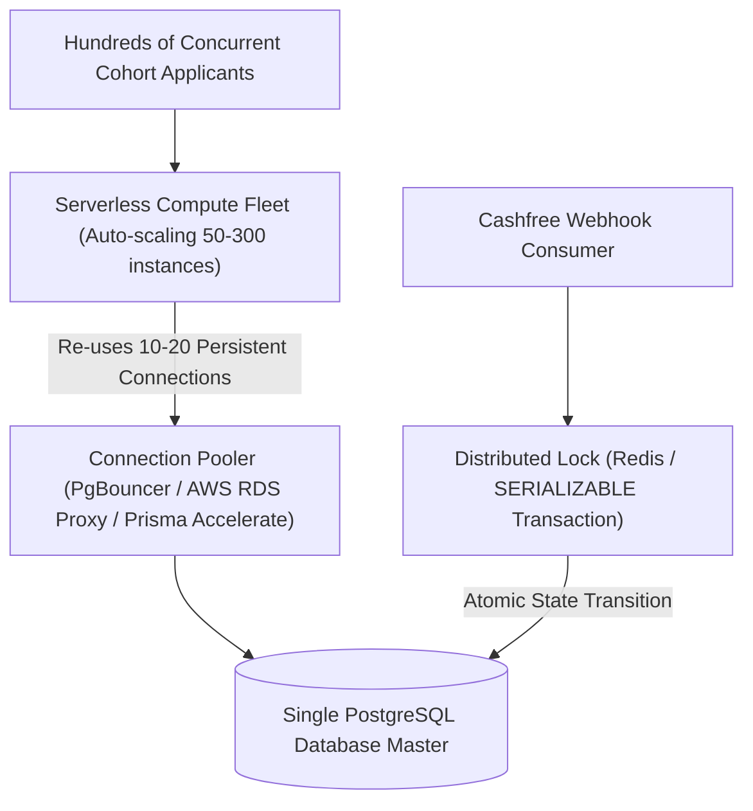

# Platform Audit: `/bitelevate` — High-Concurrency Funnel, DB Pooling & Payment Processing

## Route Context
- **Target Route**: `https://www.cynbit.in/bitelevate`
- **Observed Headers**:
  ```http
  HTTP/1.1 200 OK
  Server: Vercel
  Cache-Control: public, max-age=0, must-revalidate
  X-Vercel-Cache: HIT
  X-Vercel-Id: bom1::bbr8g-1793628992178-15eb2cb267c4
  Access-Control-Allow-Origin: *
  ```
- **Observed TTFB**: ~117ms – 189ms

---

## Technical Observations & Cohort Launch Risks

### 1. High-Concurrency Cohort Surges & Database Exhaustion
BitElevate represents Cynbit's flagship developer training and career elevation program. During promotional campaigns, deadline surges, or cohort launches, hundreds of applicants register simultaneously:
- **Serverless Concurrency Hazard**: When traffic spikes, Vercel dynamically spawns hundreds of independent serverless function instances.
- **Connection Exhaustion**: Each serverless container opens direct TCP connections to PostgreSQL (`max_connections` typically 100–300 on AWS RDS/Supabase). Without an intermediary connection pooler, the database quickly crashes with:
  ```text
  FATAL: remaining connection slots are reserved for non-replication superuser connections
  ```

### 2. Payment Gateway Webhook Race Conditions
BitElevate incorporates **Cashfree Payment Gateway** integration (`createCashfreeOrder`, `verifyCashfreePaymentStatus`).
- When a student completes payment, Cashfree sends an asynchronous webhook while the browser redirects the user simultaneously.
- If both the redirect handler and webhook update the database concurrently, race conditions occur (e.g. duplicate enrollment records, double email triggers, or mismatched payment status).

---

## Architectural Remediation: Resilient Cohort Engine



### Key Engineering Recommendations:
1. **Mandate Transaction-Level Connection Pooling**:
   Deploy **PgBouncer** or **Prisma Accelerate** between Vercel serverless functions and PostgreSQL. Maintain a small, reusable connection pool (e.g. 20 active connections supporting 5,000 requests/sec).
2. **Atomic Idempotent Payment State Machine**:
   Enforce serializable database transactions keyed by `order_id` and `cf_payment_id`. Discard duplicate webhooks instantly with idempotency checks.
3. **Cohort Domain Tagging**: Tag leads by engineering vertical (`AI Automation`, `Full Stack`, `Cloud Engineering`) at the schema level to streamline applicant evaluation pipelines.

*(See implementations in `src/services/paymentService.ts` and `src/utils/idempotency.ts`)*.
