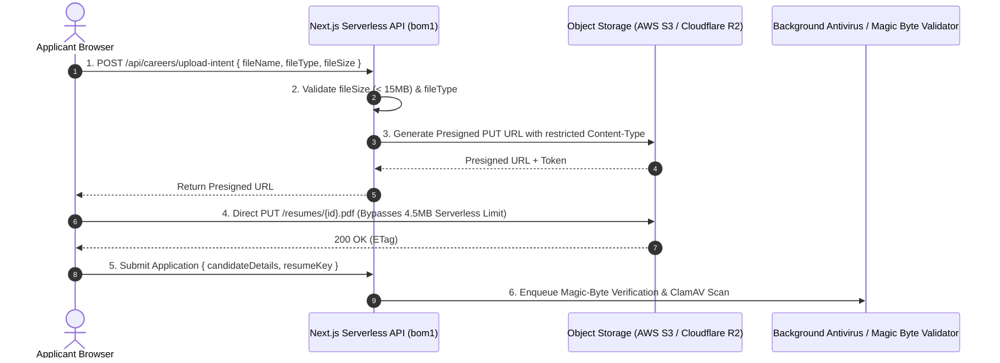

# Platform Audit: `/careers` — Resume Ingestion & Serverless Payload Limits

## Route Context
- **Target Route**: `https://www.cynbit.in/careers`
- **Observed Headers**:
  ```http
  HTTP/1.1 200 OK
  Server: Vercel
  X-Powered-By: Next.js
  Cache-Control: private, no-cache, no-store, max-age=0, must-revalidate
  X-Vercel-Cache: MISS
  X-Vercel-Id: bom1::iad1::9pjbk-1793628990724-d07b6c7e8c27
  ```
- **Observed TTFB**: **1,103ms – 1,320ms** (Origin execution in Virginia)

---

## Technical Observations & Critical Backend Bottlenecks

### 1. Cross-Continental Origin Latency
Because `/careers` dynamically fetches live job openings and intern listings from the backend database, it bypasses the edge cache (`X-Vercel-Cache: MISS`). The execution hops from Mumbai (`bom1`) to US East (`iad1`), introducing an avoidable **1+ second TTFB penalty**.

### 2. The 4.5MB Serverless Body Limit Dilemma
- When applicants upload resumes or portfolios on `/careers`, submitting multipart form data directly to a Next.js Serverless Function or Server Action encounters Vercel's strict **4.5MB maximum request body limit (`FUNCTION_PAYLOAD_TOO_LARGE` / HTTP 413)**.
- High-resolution PDF resumes or portfolio documents exceeding 4.5MB fail abruptly without graceful recovery.

### 3. File Upload Security & Magic-Byte Validation Deficit
- Inspecting applicant uploads solely by MIME type header (`Content-Type: application/pdf`) or file extension (`.pdf`) is vulnerable to MIME-spoofing attacks (uploading executable PHP/HTML/Shell scripts disguised with `.pdf` extension).

---

## Architectural Remediation: Direct-to-Storage Presigned Architecture

Instead of streaming file uploads through Next.js serverless functions, implement a **Direct-to-S3 / Cloudflare R2 Presigned Upload Pipeline**:



### Key Engineering Benefits:
1. **Bypasses Serverless Payload Limits**: Direct-to-storage uploads support up to 15MB–50MB.
2. **Offloads Function Compute**: Zero CPU/memory or network bandwidth overhead on serverless workers.
3. **Magic-Byte Verification**: Background worker verifies binary file magic bytes (`%PDF-` / `25 50 44 46`) before marking resume safe.

*(See implementation in `src/services/resumeUploadService.ts`)*.
