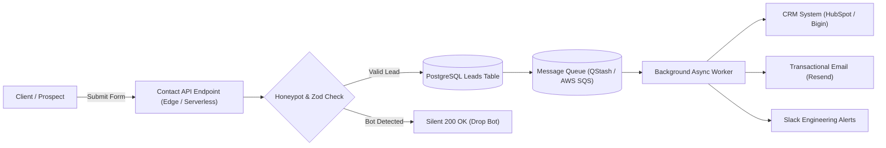

# Platform Audit: `/contact` — Lead Capture, Honeypot Bot Guards & Async Event Queues

## Route Context
- **Target Route**: `https://www.cynbit.in/contact`
- **Observed Headers**:
  ```http
  HTTP/1.1 200 OK
  Server: Vercel
  Cache-Control: public, max-age=0, must-revalidate
  X-Vercel-Cache: HIT
  X-Vercel-Id: bom1::58v8r-1793628992020-37cc11cffd2e
  Access-Control-Allow-Origin: *
  ```
- **Observed TTFB**: ~72ms – 122ms

---

## Technical Observations & Architecture Deficits

### 1. Synchronous Submission Bottlenecks
In typical web forms, submitting an enterprise contact inquiry triggers synchronous backend operations:
- Inserting a lead into the database.
- Dispatching email alerts via SMTP / SendGrid / Resend.
- Synchronizing with CRM platforms (HubSpot / Zoho / Salesforce).
- Pushing alerts to internal Slack / Discord channels.

If any external third-party API experiences latency or rate limiting, the candidate or client's form submission hangs, leading to timeouts (HTTP 504) or duplicate submissions from repeated button clicks.

### 2. Lack of Honeypot Bot Protection
Public contact endpoints are primary targets for automated spam bots submitting marketing payloads. Traditional CAPTCHAs degrade user experience, while unprotected forms flood databases and CRM funnels with spam.

---

## Architectural Remediation: Decoupled Event-Driven Ingestion Pipeline



### Key Engineering Pillars:
1. **Zero-Latency Lead Acknowledgment**: Return HTTP 200 to the user in **< 50ms** once written to database and enqueued.
2. **Invisible Honeypot Defense**: Include a CSS-hidden `company_url_verification` input. If filled, the request is flagged as an automated bot and discarded without consuming downstream quota.
3. **Resilient Retry Queue**: If third-party CRM APIs fail, the message queue automatically retries with exponential backoff and dead-letter queue (DLQ) support.

*(See implementation in `src/schemas/contactLeadSchema.ts`)*.
